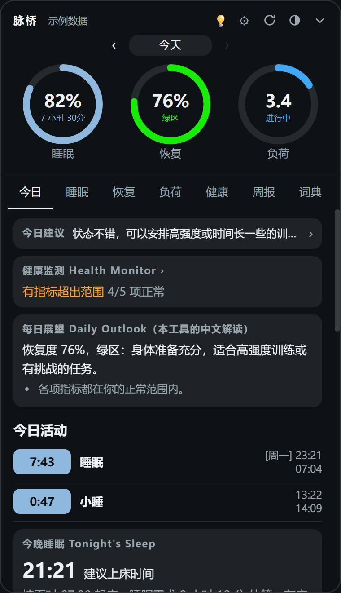
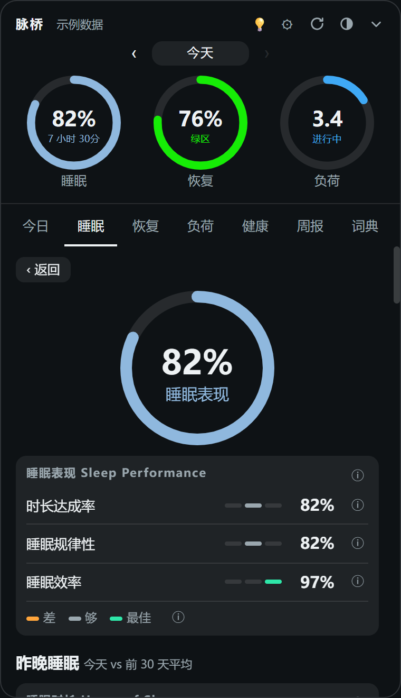
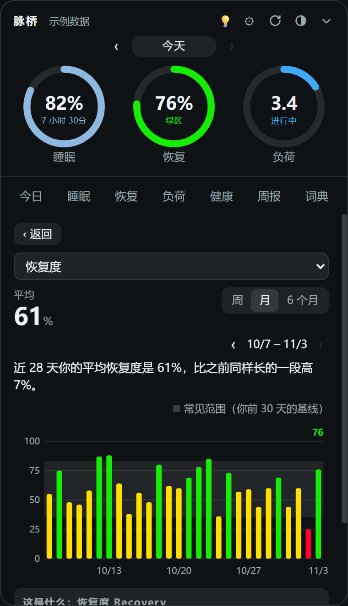
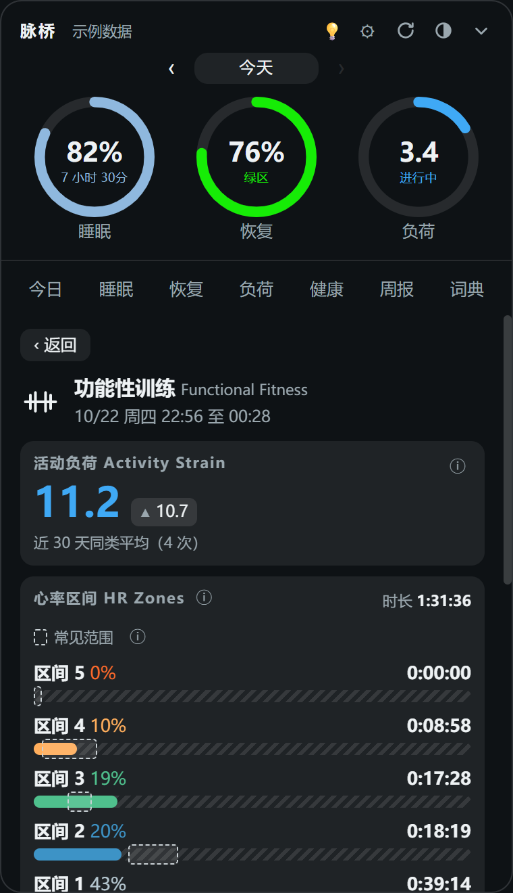
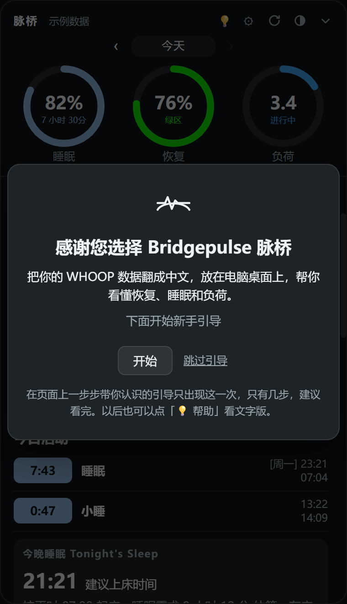
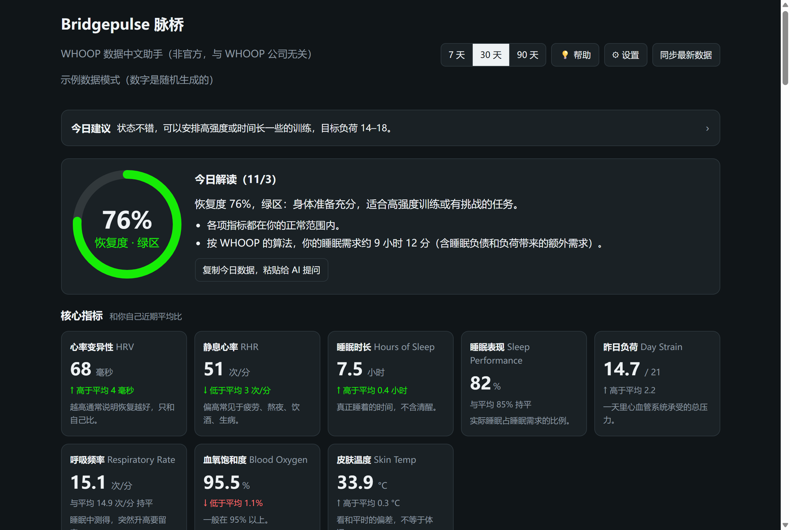

# Bridgepulse 脉桥



**WHOOP 数据中文助手（非官方，与 WHOOP 公司无关）**

把你的 WHOOP 数据翻成中文，放在电脑桌面上，帮你看懂恢复、睡眠和负荷。

> **非官方声明**：这是个人做的非官方工具，和 WHOOP 公司无关，也没有得到 WHOOP 的认可或支持；WHOOP 是 WHOOP, Inc. 的商标。它只通过 WHOOP 官方开放接口**读取**你的数据，不会修改。WHOOP App 仍然是主力。本工具只做数据解读和一般性参考，不构成医疗建议。

- 只在你自己的电脑上运行（只监听 `127.0.0.1`），数据只存在本机的 `data` 文件夹，不经过任何第三方服务器。只有你自己打开 AI 功能并点了「AI 帮我写」，才会把数字摘要发给你选的 AI（见「接入 AI（可选）」）。
- **每个人都要自己去 [developer.whoop.com](https://developer.whoop.com) 申请 Client ID 和 Client Secret**，填进自己电脑上的 `.env`。本项目不提供、也不收集任何人的 ID 和密钥，步骤见下面「第一次使用」。
- 两种看法：**桌面小工具**（半透明或不透明、可拖动、可置顶、可收起、可一键隐藏成小图标）和**网页大看板**（浏览器打开）。

## 和 WHOOP App 一样 / 不一样

| | 内容 |
|---|---|
| **一样** | 三个圆环：睡眠、恢复、负荷。睡眠、恢复、负荷详情页，单次运动详情，健康监测。近 7 天周趋势，周 / 月 / 6 个月的趋势视图。数字直接来自 WHOOP 官方接口，和 App 一致；刚同步完可能慢一点，点刷新就好 |
| **这里没有**（官方接口不开放） | 压力监测、步数、日志 Journal、AI 教练、睡眠和运动中的心率曲线、最大摄氧量、手环电量。也不能在这里添加活动或修改睡眠，请在 App 里操作 |
| **这里多出来的** | 全中文说明，每个指标点 ⓘ 就能看。今日建议：今天怎么练、今晚怎么睡、要留意什么。桌面小窗口：可以置顶、调透明度或改成不透明、收起、一键隐藏成小图标。复制数据给 AI，用中文提问；也可以自己接入 DeepSeek 等 AI（可选） |

第一次打开会有新手引导；以后随时点顶栏的「💡 帮助」再看，常见问题在 [docs/FAQ.md](docs/FAQ.md)。

## 小工具里有什么

顶部三个圆环：**睡眠**、**恢复**、**负荷**，点圆环进入对应详情页，左上角「‹ 返回」回来；「‹ 今天 ›」可以前后翻天。下面七个分页：

| 分页 | 内容 | 对应 WHOOP App |
|---|---|---|
| 今日 | 今日建议、健康监测、中文解读、今日活动（点进睡眠或单次运动详情）、今晚建议上床时间、我的仪表盘、负荷与恢复图、复制数据给 AI | Overview |
| 睡眠 | 睡眠表现和三个子指标、昨晚各阶段和常见范围、时长 vs 需求（含拆解和小睡抵扣）、规律性、效率、周趋势 | Sleep |
| 恢复 | 恢复度、HRV、静息心率、呼吸频率、睡眠表现（今天 vs 前 30 天）、中文解读、周趋势 | Recovery |
| 负荷 | 负荷和目标区间、心率区间 1–3 / 4–5、力量训练时长、当天的运动、周趋势 | Strain |
| 健康 | HRV、静息心率、呼吸频率、血氧、皮温和你自己的正常范围对比 | Health Monitor |
| 周报 | 本周 vs 上周的恢复、睡眠、负荷、运动 | Weekly Performance Assessment |
| 词典 | App 里常见英文名词、运动类型的中文意思 | — |

周趋势图右上角的「›」进入趋势视图（周 / 月 / 6 个月）。

## 截图

| | |
|---|---|
| <br>睡眠详情（示例数据截图） | <br>恢复度月趋势（示例数据截图） |
| <br>单次运动详情（示例数据截图） | <br>新手引导（示例数据截图） |



网页大看板（示例数据截图）

## 第一次使用（Windows）

### 1. 准备

- 装好 **Node.js 18 或更高版本**（[nodejs.org](https://nodejs.org) 下载 LTS 版；装好后在 PowerShell 里输入 `node -v` 能看到版本号就行）。
- 下载这个项目（GitHub 页面上的 Code → Download ZIP），解压到一个文件夹，例如 `D:\Bridgepulse`。

### 2. 安装桌面窗口组件（只需一次）

在解压后的文件夹里打开 PowerShell（在文件夹空白处按住 Shift 点右键 →「在此处打开 PowerShell 窗口」），输入：

```
npm install
```

这一步会安装 [Electron](https://www.electronjs.org/)（把网页变成桌面窗口的工具，VS Code 也是用它做的，MIT 许可证），第一次打开小工具时还会下载约 100MB 的窗口程序，并用自带的校验码核对文件。

如果下载很慢，可以先输入下面这行，改用国内镜像（只影响这个窗口），再双击启动：

```
$env:ELECTRON_MIRROR="https://npmmirror.com/mirrors/electron/"
```

### 3. 只想先看看效果

双击 **示例数据预览.bat**，不需要 WHOOP 账号，显示的都是编出来的示例数字。

### 4. 申请自己的 WHOOP 开发者 ID

每个人都要自己申请：到 [developer.whoop.com](https://developer.whoop.com) 登录 WHOOP 账号，新建一个 App，Redirect URL（回调地址）填 `http://localhost:3000/callback`，权限全部勾选读取，保存后会看到 **Client ID** 和 **Client Secret**。

### 5. 启动、粘贴 ID 和密钥、连接 WHOOP

1. 双击 **启动桌面小工具.bat**。
2. 第一次打开会直接出现设置框（以后也可以点顶栏的「⚙ 设置」），把 Client ID 和 Client Secret 粘贴进去，点「保存」。它们只保存在你电脑上的 `.env` 文件里，不会上传；已经填过的框会显示「已填写（不显示内容）」，留空就是不改。
3. 点 **连接 WHOOP**，浏览器会打开 WHOOP 登录页，登录并同意授权后，小工具会自动显示你的数据。

以后每次只需要双击 **启动桌面小工具.bat**。小工具每 30 分钟自动同步一次，也可以点右上角的刷新按钮。

**备选：手动改 `.env`**（不想用设置框时）。在项目文件夹的 PowerShell 里：

```
copy .env.example .env
```

```
notepad .env
```

把 `WHOOP_CLIENT_ID=` 和 `WHOOP_CLIENT_SECRET=` 后面的中文提示换成你的值，保存后重新打开小工具。`.env` 里是你的密钥，**不要发给任何人，也不要上传到 GitHub**（项目已经通过 `.gitignore` 排除了它）。

## 小工具的按钮

| 按钮 | 作用 |
|---|---|
| 刷新 | 立即同步最新数据（平时每 30 分钟自动同步，电脑唤醒后也会补一次） |
| 半圆 | 调整背景透明度，或者打开「不透明」 |
| 图钉 | 窗口置顶 / 取消置顶 |
| 箭头 | 收起成只显示三个圆环的小条，再点展开 |
| 隐藏 | 缩成桌面上的小图标，点一下回来；快捷键 Ctrl+Alt+W（被别的软件占用时不能用，例如微信默认的「打开微信」） |
| 💡 | 帮助：新手引导的文字版和常见问题 |
| ⚙ | 设置：粘贴 WHOOP 的 Client ID 和 Secret，可选填 AI |
| × | 关闭小工具 |

按住顶栏可以拖动，位置、置顶、收起、隐藏、透明度都会记住。

## 网页大看板

不想用桌面窗口时，也可以用浏览器看：

```
npm start
```

然后打开 http://localhost:3000 。按 `Ctrl + C` 停止。

## 接入 AI（可选）

「今日」页最上面的**今日建议**默认由本工具按规则生成，不联网。想让 AI 用口语帮你改写一遍，可以在「⚙ 设置」的「AI（可选）」里填三项，也可以直接写进 `.env`（`.env.example` 里有说明）：

| 项目 | 填什么 |
|---|---|
| `AI_BASE_URL` | 接口地址，写到 `/chat/completions` 之前为止 |
| `AI_API_KEY` | 在对应平台申请的密钥 |
| `AI_MODEL` | 模型名称 |

只要是 OpenAI 兼容的 `/chat/completions` 接口都能接，例如 DeepSeek、通义千问、Kimi、智谱、Claude、OpenAI。

**例子 1：DeepSeek**

```
AI_BASE_URL=https://api.deepseek.com
AI_API_KEY=你的 DeepSeek 密钥
AI_MODEL=deepseek-chat
```

**例子 2：Claude（Anthropic 的 OpenAI 兼容接口）**

```
AI_BASE_URL=https://api.anthropic.com/v1
AI_API_KEY=你的 Anthropic 密钥
AI_MODEL=claude-sonnet-5-5
```

在「⚙ 设置」里保存后马上生效（手动改 `.env` 的话要重新打开小工具），建议卡片上会出现 **AI 帮我写** 按钮，旁边写着数据会发到哪个域名。

- 只有点按钮时才会请求，不会自动发送；同一天的结果会先留着，再点一次才重新生成。
- 发送的内容只有最近 7 天的数字摘要和本地规则建议，不含 WHOOP 令牌、姓名、邮箱。
- 请求由本机的 `server.js` 发出，密钥不会传到页面，也不会写进日志。
- **数据会发到你填的那家公司，按它的价格按用量收费**，用之前先看一下对方的隐私政策和价格。
- 请求失败（密钥不对、余额不足、30 秒没回应等）时会显示中文原因，本地规则建议照常显示。
- 示例数据模式下不会调用 AI。

## 文件说明

| 文件 | 作用 |
|---|---|
| `启动桌面小工具.bat` / `示例数据预览.bat` | 双击启动 |
| `electron/` | 桌面窗口（无边框、半透明、置顶、记住位置） |
| `server.js` | 本地小服务器：登录、同步数据、提供页面 |
| `lib/whoop.js` | 和 WHOOP 官方 API 打交道（OAuth 授权、分页读取） |
| `lib/demo.js` | 生成示例数据 |
| `public/core.js` | 共用逻辑：个人基线、中文解读、睡眠规划、健康监测、周报、图表 |
| `public/brand.js` | 产品名和副标题（只写在这一处） |
| `public/guide.js`、`guide-ui.js`、`guide.css` | 新手引导：文字、界面、样式 |
| `docs/FAQ.md` | 常见问题（「💡 帮助」最后一页读的就是它） |
| `public/widget.*` | 桌面小工具页面 |
| `public/index.html`、`app.js`、`style.css` | 网页大看板 |
| `data/` | 运行后自动生成，存放登录令牌、数据缓存、窗口设置，已被 `.gitignore` 排除 |

## 常见问题

- **提示"还没有数据"**：新设备至少要戴着睡一晚，WHOOP 才会算出第一份恢复度。
- **提示"请求太频繁"**：WHOOP 限制每分钟 100 次请求，等一分钟再刷新。
- **想重新登录**：用网页大看板（`npm start`）点 **退出登录**，会删除本机保存的令牌和缓存。
- **小工具跑到屏幕外了**：删除 `data\widget.json` 后重新打开，会回到屏幕右上角。

本工具只做数据解读和一般性参考，不构成医疗建议。

## 许可证

MIT

许可证：MIT。名字 Bridgepulse 脉桥和图标不在 MIT 授权范围内。

Boundly 出品 · https://getboundly.com
